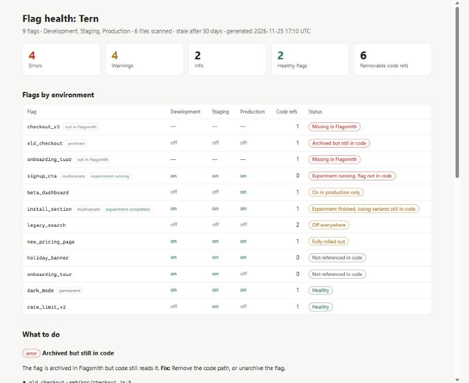
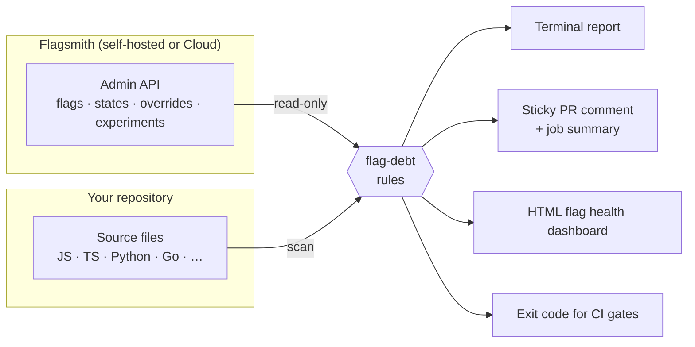

# flag-debt

[](https://github.com/Athiban-32/flag-debt/actions/workflows/demo.yml)

**Find the feature flags and experiments you forgot to clean up by comparing your code with Flagsmith, on every pull request.**

Flags are cheap to add and easy to forget. Six months later nobody knows whether
`new_pricing_page` still does anything. A typo like `onboarding_tuor` quietly returns the SDK
default. An experiment finished weeks ago, but the code still branches on the variants that
lost. Another experiment has run for a week on a flag no code reads, so it has recorded
nothing. Flagsmith knows the flag and experiment states, and your repo knows where flags are
used. **flag-debt joins the two** and tells you what to delete, what is broken, and which
lines are involved.

Built for *Toggle Wars: The Flagsmith Experimentation Hackathon* (WeMakeDevs), **Track 03:
Build on Open Source Flagsmith**. Developed and tested against **self-hosted Flagsmith**
(Docker Compose in [`selfhost/`](selfhost/)); it works the same with Flagsmith Cloud.

- **CLI**: `npx github:Athiban-32/flag-debt`, with no dependencies
- **GitHub Action**: a sticky PR comment with links to the exact lines, and a check that can block merges
- **Flag health dashboard**: one self-contained HTML page per run
- **One-command self-hosted demo**: `npm run quickstart`



See it on a pull request: [Athiban-32/flag-debt#1](https://github.com/Athiban-32/flag-debt/pull/1)
fixes the `onboarding_tuor` typo, and the flag-debt comment shows the finding go away.

## What it finds

| Finding | Severity | Meaning |
|---|---|---|
| **Experiment running, flag not in code** | error | An experiment is running on a flag no code reads, so it records no exposures and can never reach a result. |
| **Missing in Flagsmith** | error | Code calls an SDK with a key the project doesn't have (typo, or never created). The SDK silently returns the default. |
| **Archived but still in code** | error | The flag is archived in Flagsmith but code still reads it. |
| **Experiment finished, losing variants still in code** | warn | Flagsmith has a decision (for example "`os_picker` won"), but the code still branches on `one_liner` and `steps`. |
| **Fully rolled out** | warn | On, with the same value in every environment and no segment or identity overrides, unchanged for N days. |
| **Off everywhere** | warn | Off in every environment for N days. The guarded code is dead. |
| **On in production only** | warn | Enabled in production but off everywhere else, so it was never exercised before release. |
| **Not referenced in code** | info | No string in the scanned code matches the flag name. |

Every finding comes with the reason, the fix, and the `file:line` references (linked in PR
comments). Multivariate flags are never called "fully rolled out". Flags tagged `permanent`
(kill switches, ops toggles) are exempt from staleness. A finished experiment gets a grace
period (7 days by default) before it is reported.

## How Flagsmith is used

flag-debt is built on the Flagsmith Admin API and is **read-only**: it never changes a flag.
With an organisation API key, it reads:

| Flagsmith data | Used for |
|---|---|
| Projects, environments | Which project to check, and which environments are production (`--production-pattern`) |
| Features: type, tags, archived, created date, multivariate options | Missing / archived / unused, `permanent` exemptions, experiment variant values |
| Environment feature states: enabled, value, last updated | Fully rolled out, off everywhere, production only, staleness age |
| Segment and identity override counts | A flag that still targets someone is not "fully rolled out" |
| **Experiments**: status, rollout decision, winning variant, start and end dates | Unwired running experiments; finished experiments with losing branches left in code |

On the code side, a flag counts as referenced when its name appears as a quoted string
(so `FLAGS = { pricing: 'new_pricing_page' }` counts). Missing keys come from direct SDK
calls (`hasFeature('x')`, `getExperimentFlag('x')`, `get_feature_value("x")`, OpenFeature's
`getBooleanValue('x')` and more) in JS/TS, Python, Go, Java, Kotlin, .NET, Ruby, PHP, Swift,
Dart, Rust and Elixir. Losing experiment variants only count in files that read the flag or
list two or more of its variants, so a common word like `steps` elsewhere is not reported.



**How it fits with Flagsmith's own features.** Flagsmith can tag flags as stale on time alone,
and it has a code-references feature that counts where flags appear. flag-debt is
complementary. It runs as a PR check with no extra setup in Flagsmith. It catches the reverse
direction (keys in code that don't exist). It joins flag and **experiment** state with code
(archived but still read; a winner chosen but losing branches left; an experiment running on
an unread flag). And it says what to do and which lines to change.

## Quick start: self-hosted Flagsmith demo

Requires Docker and Node 20.6+. One command:

```bash
npm run quickstart
```

This does three things:
1. Starts self-hosted Flagsmith (Postgres, API, task processor) on http://localhost:8000 and
   waits until it is healthy. The first boot runs database migrations and can take several minutes.
2. Runs [`selfhost/seed.mjs`](selfhost/seed.mjs), which creates a local admin, the "Tern" demo
   project (10 flags in three environments, an identity override, a `permanent` tag, a
   warehouse connection, two metrics and two experiments: one completed with `os_picker`
   winning, one running), and an organisation API key. Details are written to the gitignored
   `selfhost/.env.demo`.
3. Scans [`example/`](example/), a small web app plus a Python worker with flag debt planted on
   purpose (the expected findings are listed in [`example/README.md`](example/README.md)). It
   prints the report and writes `flag-health.html`.

The seed backdates timestamps with SQL on the local Postgres, so staleness shows without
waiting 30 days. Other commands: `npm run selfhost:up`, `npm run seed`, `npm run demo`,
`npm run selfhost:down`, `npm test` (offline unit tests).

## Use it on your project

### CLI

```bash
export FLAGSMITH_API_URL=https://flagsmith.your-company.internal/api/v1/   # or https://api.flagsmith.com/api/v1/
export FLAGSMITH_ADMIN_API_KEY=...        # Organisation Settings → API Keys
npx github:Athiban-32/flag-debt --src . --project "My Project"
npx github:Athiban-32/flag-debt --src . --format html --output flag-health.html
```

| Option | Default | |
|---|---|---|
| `--src <dir>` | `.` | Code to scan |
| `--project <id\|name>` | the only project | Flagsmith project |
| `--stale-days <n>` | `30` | Days unchanged before a flag is stale |
| `--production-pattern <regex>` | `prod` | Matches production environment names |
| `--format text\|markdown\|json\|html` | `text` | `html` writes the dashboard |
| `--output <file>` | | Also write the report to a file |
| `--fail-on error\|warn\|none` | `none` | Exit 1 when findings at this level exist |
| `--comment` | | Post or update the PR comment (in GitHub Actions) |

### GitHub Action

```yaml
# .github/workflows/flag-debt.yml
on: pull_request
permissions:
  contents: read
  pull-requests: write
jobs:
  flag-debt:
    runs-on: ubuntu-latest   # use a self-hosted runner if Flagsmith is only on your network
    steps:
      - uses: actions/checkout@v4
      - uses: Athiban-32/flag-debt@v1
        with:
          api-url: https://flagsmith.your-company.internal/api/v1/
          admin-api-key: ${{ secrets.FLAGSMITH_ADMIN_API_KEY }}
          project: My Project
          fail-on: error               # block PRs that read missing or archived flags
          dashboard: flag-health.html  # optional: upload it with actions/upload-artifact
```

The report is posted as one PR comment that is updated on each push, and written to the job
summary. This repo's [demo workflow](.github/workflows/demo.yml) runs the whole thing in CI:
it boots self-hosted Flagsmith in the runner, seeds it, comments on the PR and uploads the
dashboard as an artifact.

### Config file (optional)

`.flagdebt.json` in the scanned directory:

```json
{
  "staleDays": 45,
  "productionPattern": "^(prod|production|live)$",
  "permanentTags": ["permanent", "kill-switch"],
  "ignore": ["generated", "fixtures"],
  "ignoreFlags": ["used_by_mobile_app"],
  "sdkMethods": ["isOn"],
  "extraPatterns": ["featureEnabled\\(Flags\\.(?<key>\\w+)\\)"]
}
```

## Limits

- **Single repo:** a flag read only by another repository or a mobile app shows as "not
  referenced". List it in `ignoreFlags`, or run flag-debt in each repo.
- **Dynamic keys:** keys built at runtime (`hasFeature(prefix + name)`) can't be seen;
  `extraPatterns` covers wrapper functions.
- **Experiments:** these need a Flagsmith version with Experimentation. On older instances the
  experiment rules are skipped and everything else works.

## Project layout

```
bin/flag-debt.mjs       CLI
src/scan-code.mjs       source walker: string literals + SDK-call keys
src/flagsmith.mjs       read-only Flagsmith Admin API client (flags, states, overrides, experiments)
src/analyse.mjs         the rules
src/report.mjs          text / Markdown / JSON output
src/html.mjs            flag health dashboard
src/github.mjs          sticky PR comment
action.yml              GitHub Action
selfhost/               Docker Compose for self-hosted Flagsmith + seed script
example/                demo codebase with planted flag debt
test/                   node:test unit tests (no network)
```

No runtime dependencies: only Node's built-in `fetch`, `node:test` and `parseArgs`.

## License

MIT
